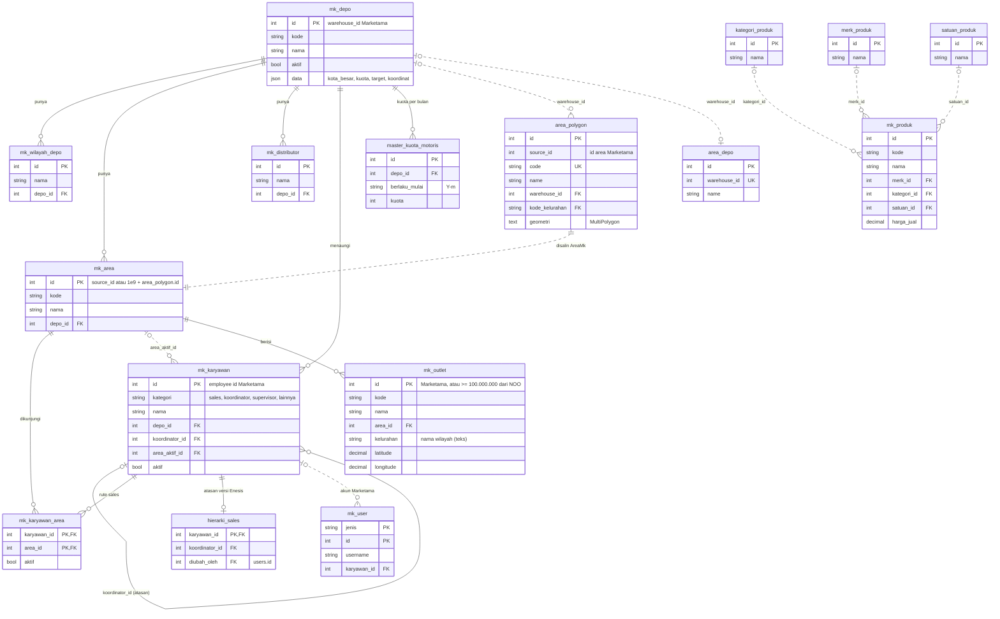
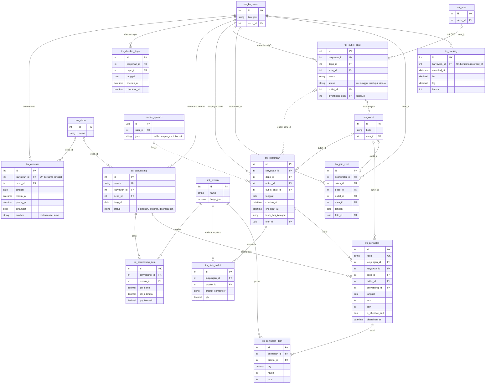
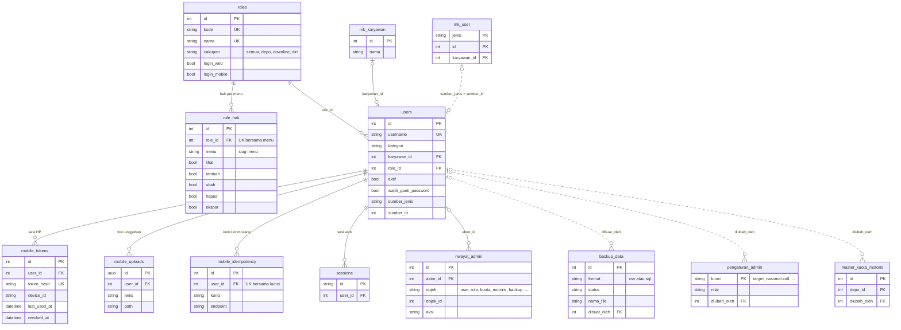
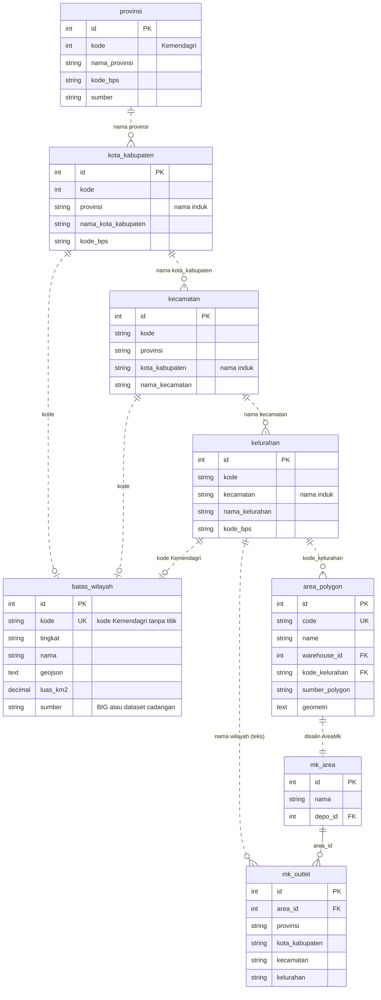
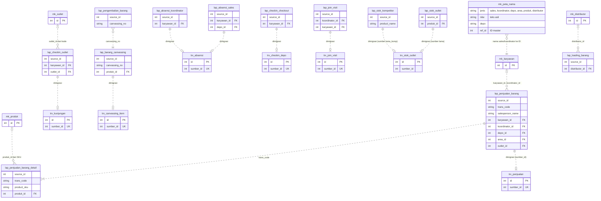

# Diagram relasi tabel (ERD)

Dibuat dari skema hasil semua migrasi (`php artisan migrate`, 150 tabel) per 28 Okt 2026. Database **tidak memakai foreign key formal**; relasi di bawah adalah relasi lewat kolom `*_id` (dan beberapa lewat nama atau kode) yang dipakai kode aplikasi.

Versi satu file (semua diagram digabung jadi satu ERD, 55 tabel / 80 relasi): [`erwin.mmd`](erwin.mmd) — bisa dibuka di [mermaid.live](https://mermaid.live) atau editor yang mendukung Mermaid.

**Cara membaca**
- Garis **tegas** = relasi lewat kolom ID (`depo_id` → `mk_depo.id`).
- Garis **putus-putus** = relasi lewat nama, kode, atau penyalinan (mis. wilayah dihubungkan lewat nama induk; `area_polygon` disalin ke `mk_area` oleh `AreaMk`).
- `||` tepat satu · `|o` nol atau satu · `|{` satu atau lebih · `o{` nol atau lebih.
- Hanya kolom kunci dan kolom penting yang ditampilkan.

Tabel yang **tidak** digambar: tabel salinan menu lama Marketama tanpa relasi (`karyawan_*`, `user_*`, `absensi_*`, `rekap_*`, `motoris_*`, dll.), data referensi datar (kategori, rumus insentif, target, hari kerja, libur), dan tabel sistem Laravel (`cache`, `jobs`, `migrations`, …).

## 1. Master & organisasi

Hasil tarikan Marketama (`mk_*`) yang dipakai aplikasi HP dan laporan motoris, ditambah isian Enesis (kuota motoris, hierarki sales, area polygon).

## 2. Transaksi aplikasi motoris

Alur harian sales: absen → checkin depo → terima canvassing → kunjungan (stok, order) → kembalikan sisa. Koordinator: join visit. Semua tabel `trx_*` juga memuat riwayat aplikasi lama hasil `enesis:migrasi-transaksi` (kolom `sumber` = `motoris` / `lama`, `sumber_id` = `source_id` lama).

## 3. Akun, role & aplikasi HP

## 4. Wilayah & area

Master wilayah berjenjang lewat **nama** induk (`kode` = kode Kemendagri tanpa titik). Batas resmi di `batas_wilayah` dicocokkan lewat `kode`; area hasil Generate Polygon Kelurahan menyimpan `kode_kelurahan`.

## 5. Data aplikasi lama (`lap_*`) dan migrasinya

Kolom `*_id` di tabel `lap_*` diisi oleh `enesis:sambung-transaksi` lewat `mk_peta_nama` (teks nama/kode → ID master). Isinya lalu dipindah ke tabel motoris oleh `enesis:migrasi-transaksi`.

Tabel `lap_*` lain yang punya kolom ID master: `lap_barang_habis_terjual`, `lap_effective_call`, `lap_effective_call_barang` (karyawan, koordinator, depo, area, outlet/produk).
